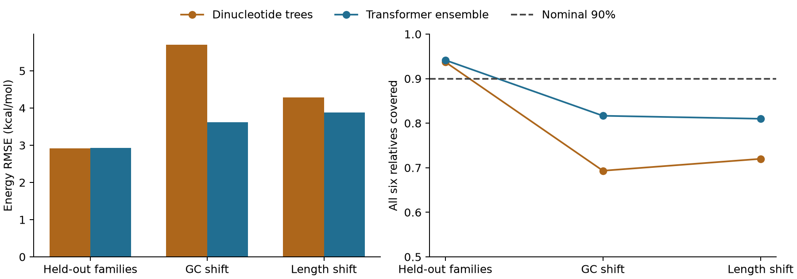

# RNA Shift Bench

[](https://github.com/aarnavbhat23/rna-shift-bench/actions/workflows/reproduce.yml)

How much should you trust an RNA folding surrogate outside its training distribution?

This repository generates **18,000 RNA sequences in 3,000 mutation families**, obtains minimum-free-energy labels from ViennaRNA 2.7.2, and trains a two-seed transformer ensemble from scratch. It evaluates entire held-out families, then changes GC content and sequence length. A dinucleotide tree baseline is included.



## What happened

| Evaluation | Dinucleotide trees RMSE | Transformer RMSE | Transformer family coverage |
|---|---:|---:|---:|
| Held-out families | 2.912 | 2.923 | 94.2% |
| GC shift | 5.703 | 3.620 | 81.7% |
| Length shift | 4.280 | 3.881 | 81.0% |

Energy errors are in kcal/mol. Coverage requires **all six relatives** in a family to fall inside their intervals. Intervals were calibrated to nominal 90% family coverage on ordinary families; their half-width is 7.477 kcal/mol for the transformer. No general coverage guarantee applies after distribution shift. The transformer does not beat the trees on the ordinary test set.

The useful result is a reproducible example of apparently conservative row coverage hiding weaker family coverage under shift. These are **computational oracle labels**, not biological experiments or a new RNA folding algorithm. The oracle itself is fast for these short sequences; this release makes no speed advantage claim.

## Reproduce

Python 3.13 was used. A free CPU can run the experiment; the recorded neural run used an Apple M3 GPU through MPS.

```bash
python -m venv .venv
source .venv/bin/activate
python -m pip install -r requirements.txt
python -m unittest discover -s tests -v
python dataset.py
python train.py --device cpu
python plot.py
python predict.py GGGGAAAACCCCGGGGAAAACCCC
```

The generated dataset, trained checkpoints, histories and held-out predictions are released here. `dataset.py` independently regenerates the CSV from seed 714. `train.py` never uses shifted labels for fitting or checkpoint selection. Seeds 714/715 selected epochs 8/4 using only the validation families. The two-layer encoder has 88,066 parameters per model; inputs are nucleotide tokens, learned positions, length and GC content. Padding is masked before pooling.

## Data and protocol

The first 2,400 families sample length 48/64/80/96 and GC probability uniformly from 0.3 to 0.7. Parent families are assigned 70%/10%/10%/10% to training/validation/calibration/test. Each parent has variants with 0/1/2/4/8/12 substitutions. A further 300 families use GC probability 0.1 or 0.9; another 300 use length 128. Generated parent families are an operational dependence unit, not a certified homology partition. Collisions across families are checked by `audit.py`.

Labels are ViennaRNA minimum free energy at the default 37°C and the paired-nucleotide fraction of that MFE structure. No partition-function ensemble, pseudoknots, cellular environment or experimental modification chemistry is modeled. An unconstrained regression head predicts energy per nucleotide and paired fraction, which can fall outside its physical range at inference.

`data/oracle.manifest.json` pins the generated CSV hash and oracle version. The manifest states which labels were computed. `results/predictions.csv` and `results/metrics.json` expose every reported test prediction and the calibration interval width; `results/history.json` records all completed training epochs. `audit.py` checks the public dataset split and regenerates reported test errors and coverage.

## Prior work and credit

RNA structure surrogates and distribution-shift evaluation are established research areas. The original contribution here is this implementation and the released mutation-family/shift experiment, not the transformer architecture or a claim of first discovery.

The oracle is [ViennaRNA](https://github.com/ViennaRNA/ViennaRNA), described by [Lorenz et al., 2011](https://doi.org/10.1186/1748-7188-6-26). Its [license](https://viennarna.readthedocs.io/en/latest/license.html) applies to the separately installed dependency. Our code is MIT; the newly generated sequence/label table is released under CC0. ViennaRNA credit is retained.

## Next experiment

A serious next test would use experimentally measured structure or an independently sourced RNA family collection, and compare several seed splits. This first release does neither. The supplied findings should be read as a controlled oracle experiment.

All numbers above come from the recorded runs, not generated example outputs. Contributions that reproduce results or identify a failure are welcome; there is no independent review or adoption claim.
